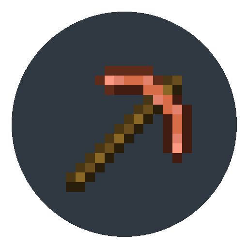

# Copper Tools

  

A lightweight Minecraft 1.21.1 NeoForge mod that adds a complete set of copper tools with authentic stats and textures.

## 🪓 Features

Adds copper variants for the core survival tools:
- **Copper Sword**
- **Copper Pickaxe**
- **Copper Axe**
- **Copper Shovel**
- **Copper Hoe**

Tools bridge the gap between Stone and Iron tier progression, crafted using copper ingots and sticks in standard tool recipe patterns.
